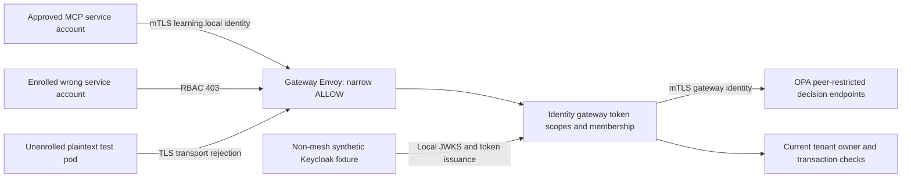

# Istio Workload Security

**Verified in an isolated local Kubernetes/Istio cluster, 2026-10-11.** This folder owns only mesh/deployment controls and connectivity verification. It reuses the identity-delegation gateway/MCP image, OPA authorization/constrained-tools Rego files and identity-delegation Keycloak realm through explicit dependencies; no application implementation is copied.

## Versions and Installation

Pinned official kind 0.33.0, Kubernetes **1.35.8** node manifest digest `sha256:07b2536e30b803ed61d1677a79df6115f798ce64c80f9e22f6ed45afd09323c0`, Istio **1.31.1**. The official Istio support matrix includes Kubernetes 1.35. Binary/archive downloads are release-checksum verified; Apple Silicon archive SHA256: `e4ab5c1400d6cc07eeb83978b4febc89b22627fd1778cc1db9b8036c187f1b80`. Tooling is project-local under ignored `.tools/`, not globally installed. Downloads require internet. Docker needs several GiB of free disk/memory; this run used an 8 GiB Docker VM and left about 9.2 GiB host disk free. No Docker pruning or existing cluster changes occurred.

First run [the identity-delegation gate](../../05-identity-delegation/code/README.md) to build prerequisite images and generate synthetic credentials, then from this folder:

```bash
bash scripts/install_tools.sh
bash scripts/create_cluster.sh
bash scripts/deploy.sh
bash scripts/check.sh
```

The dedicated cluster is `zero-trust-workload-security`. Every cluster operation uses **its own** ignored `artifacts/kubeconfig` and checks context `kind-zero-trust-workload-security`; cluster creation asserts that the user's original context stays unchanged. Do not redirect these scripts to a shared or production cluster. The original inspected context `lcp-development-1.33` remained unchanged after deployment, tests and rollback. Local Kubernetes access uses kubectl explicitly with `--kubeconfig artifacts/kubeconfig`; there is no exposed ingress/UI/NodePort here. The separate identity-delegation Compose UI remains at <http://127.0.0.1:8225/docs>.

This project has its own hardened, offline [docker-compose.yml](docker-compose.yml) for lint/format/strict-mypy gates. Mesh runtime is Kubernetes, not simulated in Compose. Deployment imports generated fixture credentials into Kubernetes Secrets via stdin and server-side apply (no token arguments or secret-bearing last-applied annotations). These local Secrets are not an external encrypted production secret store. Re-running deployment retains secrets/config maps and waits for readiness; existing in-memory fixture data persists only while its pod survives.

## Trust and Policy

The declared trust domain is **`learning.local`**, configured when installing minimal Istio. Expected approved peer: **`learning.local/ns/learning-mesh/sa/learning-mcp`**. Certificate SAN checks observe `spiffe://learning.local/ns/learning-mesh/sa/learning-mcp`; Istio `principals` rules use the documented form without the URI scheme. Dedicated gateway/OPA accounts are `learning-gateway` and `learning-opa`. Application service accounts have no cluster-admin RBAC and no default token mount; Istio injects its own audience-specific service-account token for certificate issuance. Native restartable sidecars can appear under `initContainers`, which verification handles explicitly.

Namespace `learning-mesh` has **STRICT mTLS**, no application port exceptions. Gateway AuthorizationPolicy selects only `app: learning-gateway`, admits only the approved MCP principal, port 8000 and enumerated read/tool paths/methods. The learner route uses the pinned version's `/{*}/` single-segment URI template. No ALLOW match means deny; there is no allow-all policy. OPA selects only `app: learning-opa`, admitting only the gateway peer to its two decision endpoints on 8181. Neither app authorization nor policy outage behavior is replaced by mesh authorization.



## Health and Exceptions

Kubelet HTTP probes are rewritten by Istio to its agent health port; gateway/OPA readiness passed with strict mTLS. The gateway application `/health` is allowed **only** from the approved peer, not from any workload. Proxy admin/certificate access at pod localhost 15000 is verification-only, never an ingress endpoint. No HTTP gateway is installed; adding one would require a separate explicit service account/rule and verified authentication model. No application inbound port is excluded from the mesh.

`plaintext-client` deliberately has injection disabled and a dedicated account to test unenrolled rejection; it is a negative fixture, not an exemption on the gateway. `unapproved-client` is enrolled but has the wrong service account. Separate `learning-identity-fixtures` namespace is deliberately not mesh-enrolled; Keycloak is a synthetic local test dependency with plain-HTTP/`dev-file` issuance, inherited from the identity-delegation workshop. Its file database is disposable pod storage, not a persistent volume; the change from `dev-mem` fixes an observed empty H2 session-table failure. Rollout and real issuance/mesh checks passed after this repair. The gateway's outbound JWKS traffic to it is not protected by mTLS. Production requires TLS/enrollment and an explicit egress/IdP boundary. No NetworkPolicy-wide egress isolation, compromised-node protection or production secret posture is claimed.

## Actual Checks

`bash scripts/check.sh` passed container Ruff lint/format and strict mypy (two scripts), Kubernetes server-side dry runs for every workload/security object, `istioctl validate`, and clean `istioctl analyze` against **the actual pinned cluster**. Live probes verified:

- Approved enrolled account: `/health` 200; missing user context 401.
- Actual approved and wrong-account certificate SANs match the declared trust domain/accounts.
- Wrong enrolled service account: gateway mesh RBAC 403.
- Unenrolled plaintext: connection rejected before an HTTP response.
- Approved MCP cannot call OPA directly: mesh RBAC 403.
- Real Keycloak user/workload tokens through the approved workload: own progress, four official SDK MCP tools and idempotent writes succeed; foreign learner, spoof headers, wrong token context/signature fail with no private output.

Initial integration failures exposed Kubernetes ConfigMap policy symlink duplication and an incorrect interior wildcard; named Rego files and the documented URI template repaired those deployment defects without changing policy logic. Deprecated injection annotation was replaced by its supported label and reanalysis is clean. The identity-delegation workshop's separate gate previously verified 99 Python/21 Rego tests and zero-write revocation/expiry cases. No claim is made that those are new workload-security unit tests.

## Rollback and Cleanup

```bash
bash scripts/rollback.sh
bash scripts/deploy.sh
bash scripts/check.sh
docker compose down
```

For deliberate cleanup, inspect `scripts/cleanup.sh` and set its required confirmation variable to the owned cluster name before running it. The confirmation guard must remain enabled.

Rollback **stops the gateway** and keeps strict mTLS/caller restrictions; it never opens the mesh or downgrades user authentication. Scaling to zero, idempotent restoration and all live checks were executed successfully. Cleanup is provided but not executed; the dedicated test cluster remains ready for later milestones. Deleting it discards all volatile fixture data. Production release rollback/readiness/supply-chain controls belong to the supply-chain and deployment workshops, not this local lab.